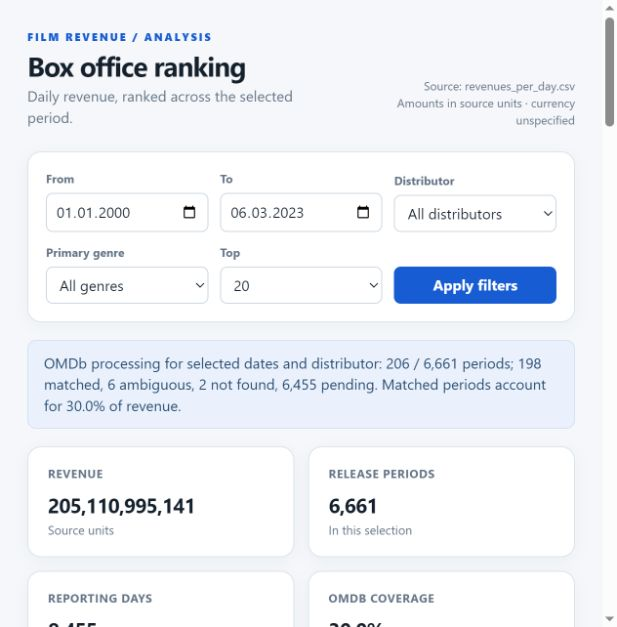
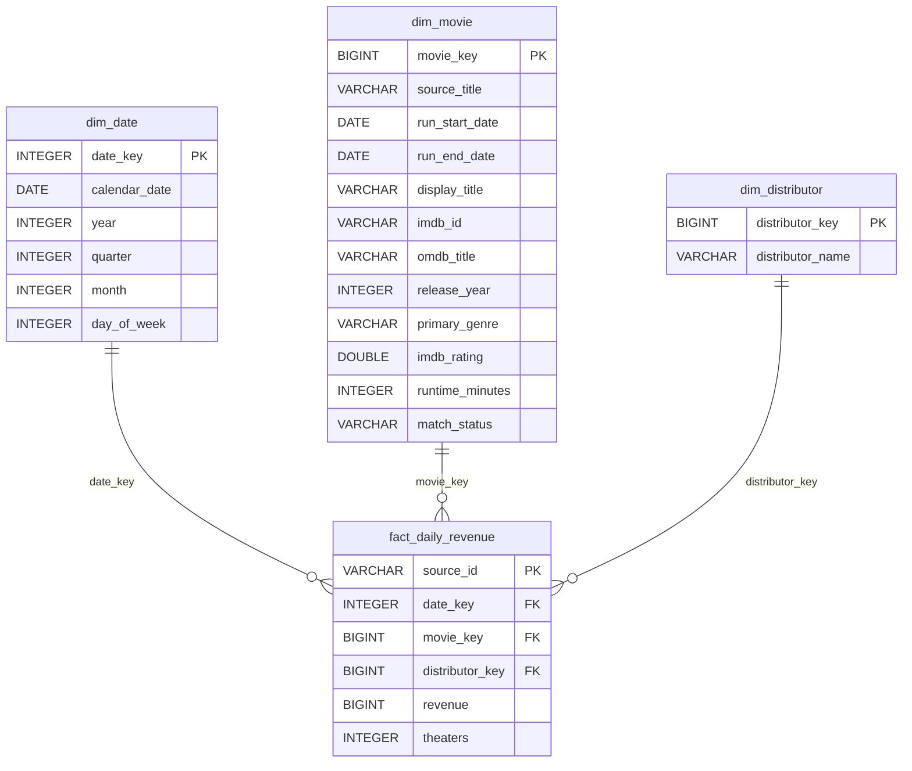

# Daily box office ranking

A local Python + dbt Core + DuckDB pipeline loads daily revenue from `revenues_per_day.csv`, enriches reporting periods with [OMDb](https://www.omdbapi.com/), and serves a ranking dashboard. Python owns imports and durable OMDb state; dbt owns reporting periods and the analytical star schema. Uses Python 3.12, DuckDB 1.5.1, dbt Core 1.11.16 and dbt-duckdb 1.11.1.



## Run

On Windows PowerShell:

```powershell
python -m venv .venv
.\.venv\Scripts\python.exe -m pip install --only-binary=:all: -r requirements.txt
.\.venv\Scripts\python.exe -m pipeline.run --csv revenues_per_day.csv
Copy-Item .env.example .env
```

Put your [free OMDb key](https://www.omdbapi.com/apikey.aspx) in `.env` as `OMDB_API_KEY=...`, then run:

```powershell
.\.venv\Scripts\python.exe -m pipeline.run --enrich --limit 100
.\.venv\Scripts\python.exe -m dashboard.server
```

Open [http://127.0.0.1:8501/](http://127.0.0.1:8501/). The default database is `data/box_office.duckdb`; all pipeline commands accept `--db`. Stop the dashboard before running the pipeline, including migration or recovery. Use `python -m pipeline.run` for imports, enrichment, full refresh and recovery.

The database and `.env` are ignored by Git. Reimporting the same CSV retains matched periods, saved OMDb responses and the request history. `python -m pipeline.run --offline` reuses saved title responses for eligible periods without an API key or new requests. Running with neither `--enrich` nor `--offline` just rebuilds analytics from saved state; it does not call OMDb.

The sequence is: copy the last published database → migrate operational state → validate/import an optional CSV → dbt staging and periods → check enriched assignments and synchronize stable keys → candidate model → optional enrichment → complete `dbt build` with tests → close connections and publish the file. A failed step stops publication. The pipeline uses one database writer and one publication lock, independently of HTTP worker count.

## dbt configuration and development

`requirements.txt` pins the complete runtime: dbt Core, its DuckDB adapter and DuckDB. Core 1.11 is used to avoid the additional experimental-parser build dependency in Core 1.12 on Windows. Versions and adapter requirements can be checked on [PyPI](https://pypi.org/project/dbt-duckdb/1.11.1/) and [dbt Core](https://pypi.org/project/dbt-core/1.11.16/).

The runner creates a temporary profile from `dbt/profiles.yml.example`, always passing an absolute database path. It supports `dev` and `ci`, with isolated per-file build artifacts under `dbt/target/` and `dbt/logs/`. Both targets use the explicitly supplied file; the CI workflow passes temporary databases and never reads the user database. For a development file:

```powershell
.\.venv\Scripts\python.exe -m pipeline.run --csv revenues_per_day.csv --db data/dev.duckdb
.\.venv\Scripts\python.exe -m pipeline.run --db data/dev.duckdb --full-refresh
```

For direct dbt inspection, first build a development file as above, then create a local ignored profile:

```powershell
Copy-Item dbt/profiles.yml.example dbt/profiles.yml
$env:MOVIES_DBT_PATH = (Resolve-Path data/dev.duckdb).Path
$env:DBT_SEND_ANONYMOUS_USAGE_STATS = 'false'
.\.venv\Scripts\dbt.exe debug --project-dir dbt --profiles-dir dbt
.\.venv\Scripts\dbt.exe parse --project-dir dbt --profiles-dir dbt
.\.venv\Scripts\dbt.exe build --project-dir dbt --profiles-dir dbt --full-refresh
.\.venv\Scripts\dbt.exe docs generate --project-dir dbt --profiles-dir dbt
```

Use `pipeline.run` when CSV data changes: it synchronizes operational registries before the final build. Direct dbt rebuilds assume this synchronization has already succeeded. Generated documentation is in `dbt/target/index.html` for direct commands; runner-generated files are under a path-specific subdirectory.

Python-owned sources and registries live in `main`. Staging views live in `staging`; intermediate views and reused period tables in `intermediate`; the four materialized marts retain their original names in `main`. The schema macro deliberately omits dbt's usual target-schema prefix. Local relation references omit the catalog so file copies can be renamed safely. Dashboard queries require no changes.

## Migration and recovery

The first pipeline run migrates a working copy of an existing database transactionally. It preserves numeric keys, selected metadata and statuses (including statuses without payloads), lookup responses, query cache and request history. `omdb_lookup` and any local review/search tables referring to `dim_movie` are reattached to `movie_registry`. Historical dates, distributors and periods remain available even after source deletions. The input schema for migration tests lives only in `tests/fixtures/pre_dbt.sql`.

`movie_registry`, `distributor_registry`, `date_registry`, `movie_metadata`, `revenue_assignments`, `import_history` and `pipeline_migrations` are durable operational tables; dbt never replaces them, even during full refresh. Empty snapshots are rejected. Revenue corrections and deletions replace the current facts, but changing a saved enriched row's title or period start is rejected before publication.

For `data/box_office.duckdb`, the working copy is `data/box_office.working.duckdb`; each successful publication first saves the previous database as `data/box_office.duckdb.backup.duckdb`. A failure retains the working copy, including every request reservation and cached response. Resume the same run:

```powershell
.\.venv\Scripts\python.exe -m pipeline.run --db data/box_office.duckdb --resume --offline
```

Add `--csv revenues_per_day.csv` when retrying a corrected import. Omit `--offline` to publish only the saved state, or use `--enrich` to continue subject to the retained rolling budget. A new run refuses to overwrite unfinished work. Keep working databases and their journals until recovery is complete.

To restore the last published backup, with the dashboard stopped:

```powershell
.\.venv\Scripts\python.exe -m pipeline.run --db data/box_office.duckdb --restore
```

Use `--backup <path>` for another saved database. Recovery carries request reservations and the newest query cache forward from both the active file and unfinished work, rebuilds and validates the backup, then publishes it. An unfinished working file is retained as `box_office.failed-<id>.duckdb`. Copying an old backup over the active file manually can lose spent API budget; use this recovery command instead. If recovery itself fails, retain the `.restoring.duckdb` candidate for investigation before retrying.

The adjacent `.pipeline.lock` prevents two pipeline publishers. After a forced process termination, first ensure no pipeline process or dashboard is running, then remove only that stale lock and resume. DuckDB file locks remain a separate check. No API requests are needed for migration, full refresh, or recovery.

Enrichment uses one worker by default. To allow up to four simultaneous OMDb requests:

```powershell
.\.venv\Scripts\python.exe -m pipeline.run --enrich --workers 4 --limit 100
```

Run one enrichment process at a time. Run and daily request limits still apply, including fallbacks, timeouts and interrupted requests. An invalid key or exhausted quota stops new requests; calls already in flight may finish. With a small budget, worker count can affect which periods get processed before the limit is reached.

To revisit ambiguous periods, stop the dashboard and run:

```powershell
.\.venv\Scripts\python.exe -m pipeline.run --enrich --retry-ambiguous --limit 100
```

When a title-only response has an incompatible release year, the pipeline makes one additional query using the year of the first revenue record. The same matching rules still apply. Each network request counts toward both `--limit` and the daily cap. If the fallback is unavailable, unsuccessful or uncertain, the period stays `ambiguous`; rerun with `--retry-ambiguous` after a limit or temporary error. Cached results can also be reviewed with `--retry-ambiguous --offline`.

## Data and model

The CSV contains **337,818 rows**, **6,545 distinct titles**, **363 distributors**, and **8,455 dates** from **2000-01-01 to 2023-03-06**. Total box office gross is **$205,110,995,141**; 161 theater counts are missing. The CSV has no explicit currency or market metadata, but its **Avengers: Endgame** rows sum to **$858,373,000**, matching the published [domestic theatrical gross](https://www.boxofficemojo.com/title/tt4154796/) exactly. The dashboard therefore treats `revenue` as nominal **USD domestic theatrical box office gross**, covering the **US and Canada** ([Box Office Mojo's definition](https://www.boxofficemojo.com/article/ed3547792388/)). It is ticket sales, not distributor profit or worldwide revenue. This interpretation has not been verified for every CSV row.

The fact grain is one CSV row for a title, distributor and day. `revenue` is additive. `theaters` is a row-level value and should not be summed as a count of unique cinemas. A title starts a new reporting period after more than 180 days without a revenue record. This is a heuristic for separating likely rereleases or remakes, not proof of film identity.



`raw_revenues` keeps the parsed CSV snapshot. `omdb_lookup` stores the selected response and classification for each queried period; `omdb_request_log` counts requests toward the safety cap. `omdb_query_cache` stores responses by source title and query year (0 means no year filter), keeping title-only and year-specific queries separate. Existing saved responses are copied into this cache automatically. Reused responses are checked again against the current period's dates. Only an exact normalized title and plausible release year become `matched`; all fact revenue stays in the model even without a match. The film ranking combines matched periods by IMDb ID. The release-period ranking includes every period.

Examples encountered during matching include **The Lion King** (2019 revenue versus a 1994 title-only candidate, resolved by the year-specific query), **Legally Blonde 2** (shortened source title versus the longer OMDb title, *Legally Blonde 2: Red, White & Blonde*), and **American Sniper** (revenue starting in December 2014 versus an OMDb year of 2015). The latter two remain ambiguous. These cases illustrate title collisions, title variations, and release-year discrepancies. Revenue remains in the model even when metadata cannot be assigned. Conservative matching can also reject valid candidates; these cases require review rather than automatic acceptance.

OMDb can return short films under `Type=movie`. Year-specific queries for **Coco (2020)** and **The Revenant (2015)** returned short films with matching titles and years. Candidates whose genre includes `Short` therefore remain `ambiguous` for manual review, even when title and year agree. This is a conservative rule for this dataset, not proof that all short-film revenue records are invalid.

## Demonstration

The local database on 25 September 2026 had **6,661 periods**, of which **908 had been processed**: **878 matched**, **19 ambiguous**, **11 not found**, and **5,753 pending**. Matched periods covered **66.94% of source revenue**. This is coverage, not match accuracy.

Rechecking the 34 ambiguous periods used **28 new API requests** and resolved **15 periods**, increasing revenue coverage from **65.77% to 66.94%** (1.17 percentage points; **$2.40 billion** of additional revenue linked to OMDb metadata). Two short-film candidates were excluded after response review. The total fact revenue did not change.

Enrichment is intentionally partial due to the free OMDb API request limit. Subsequent runs continue processing pending titles while reusing cached responses. All CSV revenue records are loaded regardless of enrichment status. A clean checkout has no saved OMDb responses; `--limit 100` processes the highest-revenue pending periods first. The [free OMDb tier](https://www.omdbapi.com/apikey.aspx) lists 1,000 requests per day; this pipeline caps itself at 900 in a rolling 24-hour window. Use `--daily-cap` to set a lower ceiling.

Across the full source date range, the largest reporting period was **Star Wars: Episode VII - The Force Awakens** at **$935,644,139**. In 2019 the leader was **Avengers: Endgame** ($858,373,000); in 2022 it was **Top Gun: Maverick** ($716,981,130). **Walt Disney Studios Motion Pictures** contributed **17.32%** of gross across all dates. These statements use the complete fact table; the confirmed-film ranking is limited by OMDb coverage.

Each ranking can be sorted independently by its visible columns in either direction. Sorting runs before the selected Top 10/20/50/100 limit, so the tables and their CSV exports reflect the full filtered dataset. The Top release periods chart always shows the ten highest grosses.

## Analytical observations

The following observations use all revenue records in the fact table, regardless of OMDb match status:

- **Pandemic-era decline:** recorded gross fell from **$11.21 billion in 2019** to **$1.98 billion in 2020**, a decline of **82.3%**. The monthly series drops sharply in March and reaches just **$34,369 in April 2020**. The timing is consistent with disruption during the COVID-19 pandemic, but the CSV alone does not establish causation or completeness of market coverage.
- **Gradual recovery:** recorded gross increased to **$4.07 billion in 2021** and **$7.27 billion in 2022**. The 2022 total remained **35.1% below 2019**, in nominal terms without inflation adjustment.
- **Seasonality:** across 2000-2019, July had the highest average recorded daily gross (**$36.82 million**), followed by June (**$32.48 million**) and December (**$30.84 million**). Comparing daily averages accounts for differences in month length. The largest monthly total in the dataset was **July 2011: $1,380,301,220**.
- **Incomplete final month:** the dataset ends on **6 March 2023**, so the last chart point contains only six days (**$136.25 million**). It should not be compared directly with full monthly totals or interpreted as another market collapse.

## Verify

```powershell
.\.venv\Scripts\python.exe -m unittest discover -s tests -v
```

The import checks required fields, duplicate IDs and duplicate date/title/distributor groups in a transaction. dbt then checks contracts, unique and required keys, dimension relationships, match statuses, valid revenue/theater values, row-by-row equality and totals grouped by date, title and distributor. The whole pipeline publishes a validated working database; a `dbt build` is not treated as one global transaction. Reloads preserve saved OMDb responses and reject a change that moves already-enriched source rows to a different reporting period. OMDb metadata is user-maintained and title matching can be wrong, so ambiguous periods remain separate.

The CI workflow runs the Python and dbt integration tests on Windows and Linux using Python 3.12, a small checked-in CSV and fixture OMDb responses, without network calls to OMDb or secrets. It covers migration rollback/idempotency, 180/181-day boundaries, multiple distributors, corrections/deletions, empty CSV rejection, full refresh, dashboard queries, failed publication, retained request budget and recovery.

For local validation against the complete CSV and an optional existing database (only a copy is migrated):

```powershell
.\.venv\Scripts\python.exe -m benchmarks.verify_dbt --db-snapshot data/box_office.duckdb
```

Each validation needs a new output directory; pass `--output-dir benchmarks/results/dbt-validation-new` for another run. dbt reconciles the CSV through its data tests. The verifier checks repeated full refresh, stable numeric keys, saved operational tables, column types and dashboard results. With `--db-snapshot`, it migrates a copy and verifies that keys and API state survive. This verification generates dbt documentation and never calls OMDb. It uses only the current dbt pipeline and does not load code from Git history.

Raw results stay local in the Git-ignored `benchmarks/results/`. The optional `python -m benchmarks.smoke_omdb` uses the configured key for a live check, with a shared maximum of four requests per rolling 24 hours. Its request ledger stays in `benchmarks/results/live_omdb.duckdb`; retain it so repeat runs respect the budget.
