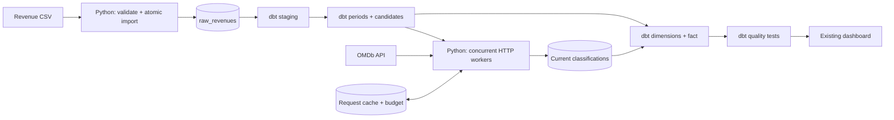

# Movies: Python concurrency + dbt + DuckDB

A local educational data pipeline and box office dashboard. Python validates CSV snapshots and fetches OMDb metadata; dbt owns reporting periods, the star schema, lineage and data tests. DuckDB stores both. Use Python 3.12 and the runtime versions pinned in `requirements.txt`.




## Setup and commands

Windows PowerShell:

```powershell
python -m venv .venv
.\.venv\Scripts\Activate.ps1
python -m pip install --only-binary=:all: -r requirements.txt
python -m pipeline.run --csv revenues_per_day.csv --offline
python -m dashboard.server
```

Linux/macOS: activate with `source .venv/bin/activate`; the remaining commands are identical. Open [localhost:8501](http://127.0.0.1:8501/). Stop the dashboard before pipeline/dbt commands. The new default is **`data/movies.duckdb`**, separate from older `data/box_office.duckdb` files. Pipeline and dashboard commands accept `--db`.

```powershell
# Rebuild and revalidate cache, without network access (also the default mode)
python -m pipeline.run --offline

# Opt into HTTP: set OMDB_API_KEY in the environment or copy .env.example to .env
python -m pipeline.run --enrich --workers 4 --limit 100 --daily-cap 900

# Replace the complete snapshot, including corrections and deletions
python -m pipeline.run --csv revenues_per_day.csv --offline

# Isolated development database
python -m pipeline.run --csv tests/fixtures/revenues.csv --db data/dev.duckdb
python -m dashboard.server --db data/dev.duckdb --port 8502

# Python tests include real dbt builds/tests and local dashboard HTTP checks
python -m unittest discover -s tests -v

# Full CSV acceptance test: builds twice, compares every mart row, blocks HTTP
python -m tests.verify_full --db data/full-check.duckdb
```

`.env`, keys, databases, journals and generated dbt output are ignored by Git. The dashboard's only change from `main` is its default database filename; filters, sorting, rankings and both CSV downloads retain the existing implementation.

## Airflow 3 in WSL2

The version-controlled DAG is `dags/movies_steps.py`. Airflow and Movies keep separate
virtual environments: Airflow imports only its SDK and standard provider; each task
executes `/home/nacho/projects/Movies/.venv/bin/python -m pipeline.steps` in the Movies
repository. No Airflow packages are needed in the Movies environment. Airflow needs
`apache-airflow-providers-standard` (included in the tested installation).

In Ubuntu, first update `/home/nacho/projects/Movies` to this implementation on
`simplified-dbt`, then install the link and check parsing:

```bash
cd /home/nacho/projects/Movies
.venv/bin/python -m pip install -r requirements.txt
bash scripts/install_airflow_dag.sh
/home/nacho/airflow/.venv/bin/python -m tests.verify_airflow
/home/nacho/airflow/.venv/bin/airflow dags list --local
```

The installer links only `movies_steps.py` into `/home/nacho/airflow/dags` and refuses
to replace a different existing file. Re-running it is safe; source edits are visible
through the link. `hello_movies` and `movies_local` are unchanged. The DAG expects
the repository at `/home/nacho/projects/Movies`; edit `MOVIES_REPO` in the DAG if moved.

With your existing Airflow services running, wait for `movies_steps` to appear, then
unpause and trigger it in the UI, or use:

```bash
/home/nacho/airflow/.venv/bin/airflow dags unpause movies_steps
/home/nacho/airflow/.venv/bin/airflow dags trigger movies_steps
# Optional local execution without the scheduler (executes real tasks):
/home/nacho/airflow/.venv/bin/python -m tests.verify_airflow --run
# Isolated failing-ingest check; confirms four downstream tasks never start:
/home/nacho/airflow/.venv/bin/python -m tests.verify_airflow --failure
```

| Task, in order | Operation |
| --- | --- |
| `ingest` | Validate `revenues_per_day.csv` and atomically import it with `import_snapshot` |
| `dbt_prepare` | `run_dbt(..., 'run', '--select', '+int_omdb_candidates')` builds reporting periods and enrichment candidates |
| `enrich_omdb` | Existing `enrich` worker/cache logic, with no key and both HTTP budgets set to zero |
| `dbt_build` | Complete `run_dbt(..., 'build')`, including dbt data and unit tests |
| `validate` | Read-only checks: 337,818 facts, revenue 205,110,995,141, 6,661 periods, source reconciliation and zero OMDb reservations |

All tasks use **`data/movies_steps.duckdb`**, leaving other Movies databases untouched.
Enrichment is offline even if `OMDB_API_KEY` is set; no key is loaded from `.env`.
The full bundled CSV is required for the final acceptance counts. Each stage can
also be run manually, for example `.venv/bin/python -m pipeline.steps validate`.

The DAG is manual (`schedule=None`, `catchup=False`). One active run, one active task
and the strict `ingest >> dbt_prepare >> enrich_omdb >> dbt_build >> validate` chain
serialize writes. Do not run manual pipeline commands, a second DAG or a dashboard
against this same database while the DAG is running.

Each dbt task allows two retries after the initial attempt, with a one-minute delay
and exponential backoff, and a 30-minute timeout per attempt. Other tasks have no
automatic retries and a 10-minute timeout. A nonzero process exit fails its task;
downstream tasks wait for success and become `upstream_failed` after retries are
exhausted. Fix the cause, then clear the failed task and its downstream tasks in the
UI to retry. Saved raw/cache state survives; dbt builds are not atomic, so wait for a
successful build before serving the database.

Open **Dags → movies_steps → run → task → Logs** to inspect start messages, JSON
results and failure tracebacks. dbt failure output is included; its detailed logs
also live under `dbt/logs/` in a database-specific subdirectory. Task output stays
in logs; XCom pushes are disabled.

See [executed Airflow validation](docs/airflow-validation.md) for results and limits.

## Responsibilities and lineage

| Component | Owns |
| --- | --- |
| `pipeline/ingest.py` | Strict CSV validation; transactional snapshot replacement |
| `pipeline/enrich.py` | HTTP, conservative matching, cache, budget reservations and optional legacy cache copy |
| `pipeline/run.py` | CLI, step ordering, dbt invocation and failure propagation |
| `dbt/models/` | All analytical transformations, dimensions, facts and documentation |
| `dashboard/` | Read-only queries and presentation |

dbt uses ordinary `source()` and `ref()`, with **no custom macros**. All models live in DuckDB's `main` schema; directories express the layers.

```text
source('python', 'raw_revenues') -> stg_revenues
  -> int_title_dates -> int_reporting_period_dates -> int_reporting_periods
  -> int_revenue_periods (joins dates + periods) -> int_omdb_candidates
  -> dim_date / dim_distributor
source('python', 'omdb_matches') -> stg_omdb_matches
int_reporting_periods + stg_omdb_matches -> dim_movie
int_revenue_periods + all three dimensions -> fact_daily_revenue
```

Staging and small intermediate models are views. Reused period/assignment models and the four marts are full-refresh tables. Python runs `dbt run --select +int_omdb_candidates`, reclassifies current periods from cache/optional HTTP, then runs `dbt build`. All Python connections close before dbt opens the file. dbt makes SQL dependencies, lineage and quality tests visible independently of HTTP code.

For direct dbt commands, select an absolute database path. The committed profile has no secrets:

```powershell
$env:MOVIES_DBT_PATH = (Resolve-Path data/dev.duckdb).Path
$env:DBT_SEND_ANONYMOUS_USAGE_STATS = 'false'
dbt debug --project-dir dbt --profiles-dir dbt
dbt build --project-dir dbt --profiles-dir dbt
dbt test --project-dir dbt --profiles-dir dbt
dbt docs generate --project-dir dbt --profiles-dir dbt
dbt docs serve --project-dir dbt --profiles-dir dbt
```

On Linux/macOS use `export MOVIES_DBT_PATH="$(pwd)/data/dev.duckdb"` and `export DBT_SEND_ANONYMOUS_USAGE_STATS=false`. Use the Python runner after CSV changes: direct dbt builds do not reclassify metadata. A boundary mismatch yields `pending` until Python revalidates it. Runner artifacts are separated by database path under `dbt/target/` and `dbt/logs/`; direct commands use the default directories.

## Data and identifiers

The CSV has **337,818 rows**, **6,545 titles**, **363 distributors**, **8,455 dates** and gross **$205,110,995,141**. Dates span 2000-01-01 to 2023-03-06; 161 theater counts are missing. Revenue retains the dashboard's interpretation of nominal USD domestic theatrical gross (US and Canada). The CSV itself specifies neither currency nor market.

Each fact retains its exact source ID, integer revenue and nullable theaters. Revenue is additive; theaters must not be summed as unique cinemas. A title starts another reporting period after a gap **strictly greater than 180 days**, over distinct title/date pairs independently of distributor. Unmatched/ambiguous metadata never removes revenue.

Movie keys are full MD5 strings of the JSON array `[exact source_title, ISO run_start_date]`; distributor keys are full MD5 strings of exact distributor names. Date keys are YYYYMMDD integers. The dashboard does not require numeric movie/distributor keys. Uniqueness tests detect key collisions; no registries are needed.

Historical records can move a period start or merge/split periods. A changed start produces a new key; a changed end invalidates the old classification join too. **Every pipeline run reclassifies all current periods** from request cache, checking title, release year, movie type, IMDb ID and the `Short` genre. Old matches are never transferred by key. A release year may be at most two years before the period's first year; periods spanning over three years remain ambiguous. A release-year mismatch permits one year-specific fallback using the first reporting year. Short films, shortened titles and uncertain results remain ambiguous. Only matched results populate metadata in `dim_movie`.

Trade-off: period keys are reproducible for a fixed snapshot, **not permanent external identifiers**. Exported keys may change after historical corrections. Cache survives, but valid rereleases and title variations can remain ambiguous. Reporting periods are a heuristic, not proof of film identity. There is no manual override system.

## Concurrency and durable state

HTTP spends most of its time waiting, so `ThreadPoolExecutor` overlaps those waits. Workers only perform HTTP and decode responses. The caller alone reads/writes DuckDB, classifies periods and reserves budget. No shared database connection crosses into workers.

Bounded batches use four workers by default (configurable 1–32). Periods sharing a request title share a title-only request; year-specific fallbacks are deduplicated too. The exact title sent to OMDb is NFKC-normalized, casefolded and whitespace-collapsed. Punctuation and accents remain in the cache identity. Requests fix `type=movie`. The key is `(query_title, query_year)`, where zero denotes no year filter. Matching uses a separate title comparison.

Four Python-owned tables live in `movies_state`:

| Table | Purpose |
| --- | --- |
| `raw_revenues` | Validated current CSV snapshot |
| `omdb_cache` | Reusable successful/not-found JSON responses by request identity |
| `omdb_requests` | Timestamped reservations, including errors/interruption |
| `omdb_matches` | Current classifications; replaceable derived state |

Every HTTP call, including fallbacks, autocommits a reservation **before dispatch**. The inclusive rolling 24-hour count includes incomplete requests. `--limit` caps the run; `--daily-cap` caps the rolling window and cannot exceed 900. Timeouts, malformed/error responses and HTTP failures consume budget but are not cached. Invalid keys/quota stop new batches; in-flight calls may finish. Saved cache and budget survive interruption. A rerun retries uncached failures; there are no immediate automatic retries. Not-found responses stay cached. To refresh one, explicitly delete that request's cache row while the pipeline is stopped.

Batches favor readability over maximum throughput: each waits for its slowest request. Cache has no TTL and reservations are retained indefinitely. Run one pipeline process at a time; DuckDB enforces a writer lock across processes. Budget assumes one API key per database; separate files and other OMDb clients do not share it.

## Existing databases and failures

Existing `main`/`dbt` databases are **refused**, not automatically migrated. Choose a new file. With old pipeline/dashboard processes stopped, optionally copy reusable cache and reservations:

```powershell
python -m pipeline.run --csv revenues_per_day.csv --db data/new-movies.duckdb --reuse-cache-from data/box_office.duckdb --offline
```

The source opens read-only. This supports legacy `main.omdb_query_cache` and `main.omdb_request_log` tables from `main`/`dbt`; it copies no classifications/keys. Reservations carry over conservatively and deduplicate by request ID. Use this once into a fresh destination; existing destination cache takes precedence. Keep the original file. Missing legacy tables cause a clear failure without modifying the source; there is no generic migration framework.

CSV validation/replacement is transactional: bad/empty input leaves previous raw rows intact. dbt builds in place; tests must pass before success is reported. A failure stops the runner and preserves already saved cache/reservations. **The multi-model dbt build is not atomic.** After a failed build, keep the dashboard stopped, fix the issue and rerun before serving. No automatic backup/restore/resume framework is included.

## Quality checks and CI

Python tests use small fixtures and fake HTTP responses without OMDb secrets. They cover invalid/duplicate CSVs, large exact integers, corrections/deletions, idempotency, ambiguous matching, cache revalidation, offline mode, concurrency, budgets, failures/interruption, read-only legacy copying, SQL failure propagation and dashboard queries/HTTP routes.

dbt tests enforce unique/non-null keys, relationships, accepted status/weekday values, valid revenue/theaters, and exact source-to-fact rows and grouped-gross reconciliation. Two SQL unit tests cover 180/181-day boundaries and distributor-independent date deduplication ([dbt documentation](https://docs.getdbt.com/docs/build/unit-tests)). Negative-control integration tests corrupt facts and confirm reconciliation and relationship failures are detected.

GitHub Actions runs on Windows and Linux: pinned dependency installation, dependency checks, Python tests, an isolated offline fixture build and explicit dbt tests. It invokes the ordinary runner instead of the old migration/publication benchmark and requires no API secrets. The old workflow's unquoted install command contained `--only-binary=:all:` followed by a space, which is invalid YAML. The new workflow quotes it; the old parsing failure was reproduced locally. Hosted jobs have not been run from this local branch. See [executed validation and complexity comparison](docs/validation.md).
